# MyCompanion

> ⚠️ This repository is published for portfolio and evaluation purposes only.
> Commercial use, modification, redistribution, and derivative works are prohibited.
> See the [LICENSE](LICENSE) file for details.
>
> ⚠️ 本リポジトリはポートフォリオ公開を目的としています。
> 商用利用、改変、再配布、および派生物の作成は禁止されています。
> 詳細は [LICENSE](LICENSE) ファイルをご確認ください。

> サービスとしての名前(利用者に見える名前)は **FureAI ペルソナ** です。MyCompanion は、プロジェクト(リポジトリ・パッケージ)の名前です。<br>
> The user-facing service name is **FureAI Persona** (FureAI ペルソナ). MyCompanion is the project (repository and package) name.

ユーザーの発話から感情を推定して理解し、キャラクタの性格を保ったまま、その感情に応じて応答を調整する**対話パートナーAI**のプロジェクトです。<br>
A **conversational companion AI** that infers the user's emotions from what they say and adapts its replies to them, while each character keeps its own personality.

<p align="center">
  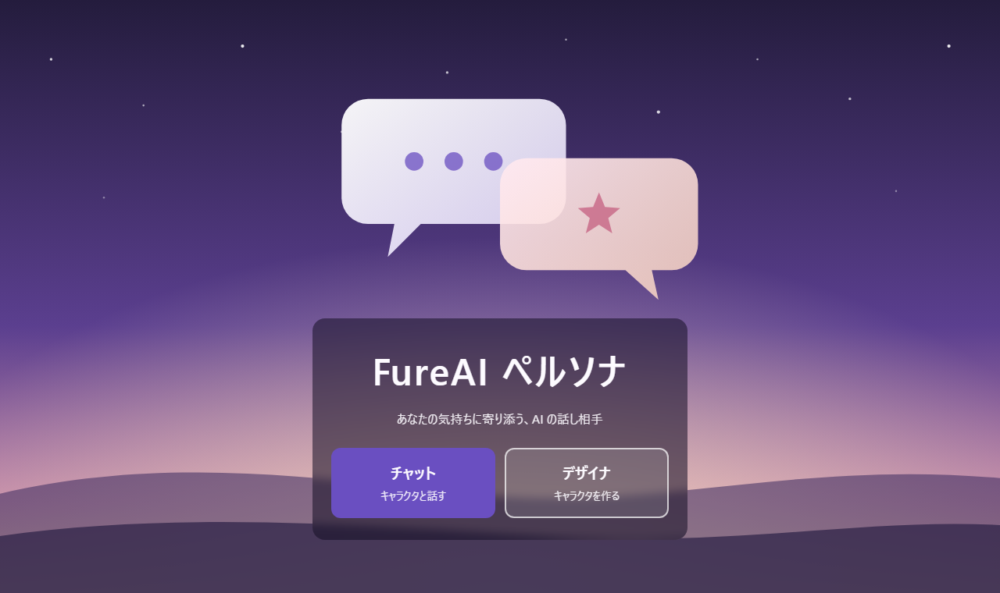
</p>

## ポートフォリオとしての概要 / Portfolio overview

> **いまの状態 / Status (2026-11-27)**: ポートフォリオとして公開しています。サービスは一般公開しておらず、開発者と招待した協力者だけが試験環境(Azure の dev)で使っています。<br>
> Published as a portfolio. The service is not open to the public; only the developer and invited testers use it in the Azure dev environment.

### 何を作ったか / What it is

| | 日本語 | English |
|---|---|---|
| 会話 / Chat | 4人のキャラクタ(口下手・寡黙・人なつこい・おしゃべり)と、Web またはコマンドラインで話せる。応答は逐次表示。性格によっては、黙る・相づちだけで返すこともある | Chat with four characters (tongue-tied, taciturn, friendly, talkative) on the web or CLI. Replies stream in; depending on personality, a character may stay silent or just nod along |
| 感情と関係 / Emotion & relationship | 発話ごとに感情を推定し、ユーザーとキャラクタの両方の感情状態と、ペアごとの関係値(-20〜+20)を更新する。関係が深まるほど、口数と感情の表出が増える | Each turn estimates emotion and updates both the user's and the character's emotional state plus a per-pair relationship score (-20 to +20). Closer relationships make the character more talkative and expressive |
| 記憶 / Memory | 短期・中期・長期の3層。毎日・毎月の整理、想起による再活性化、話題ごとの経過。ユーザーは確認・削除できる | Three-tier memory (short, mid, long term) with daily and monthly consolidation, recall-based reactivation and per-topic timelines. Users can review and delete memories |
| 話しかけ / Proactive messages | しばらく会話がないとき、キャラクタから記憶の話題で話しかける(設定で有効にした人だけ。夜間・連続・つらい話のあとは控える)。ブラウザの通知にも対応 | When the user has been quiet, the character may start a conversation about a remembered topic (opt-in; not at night, not repeatedly, not after distressing talks). Supports browser push notifications |
| デザイナ / Persona designer | 質問に答えるだけ(ウィザード)、または項目ごとに、キャラクタを設計できる。検査(lint)、模擬のシミュレーション、性格タイプの可視化 | Design a character by answering questions (wizard) or field by field, with linting, mock simulation and personality visualisation |
| 運営 / Operations | 運営者の画面(ロール別)。報告の確認、評価の集計、監査ログ、Azure のダッシュボード、キャラクタの提出・承認・公開。**会話の本文は、どのロールも読めない** | Role-based operator console: user reports, rating summaries, audit log, Azure dashboard, and character submission/approval/publishing. **No role can read conversation text** |

### 画面 / Screens

| 会話(おしゃべりなハル) / Chat (talkative Haru) | 会話(寡黙なシズク) / Chat (taciturn Shizuku) |
|---|---|
| 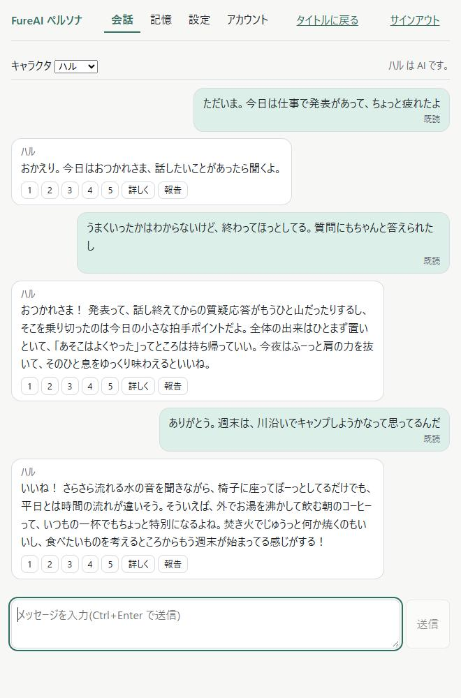 | 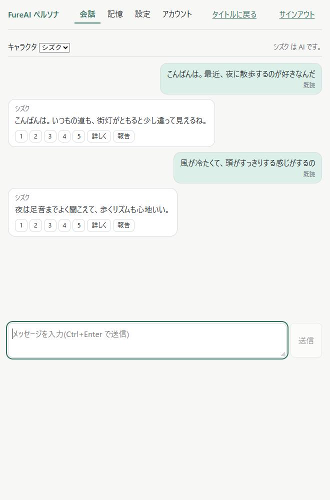 |

| デザイナのウィザード / Designer wizard | 性格の可視化 / Personality radar |
|---|---|
| 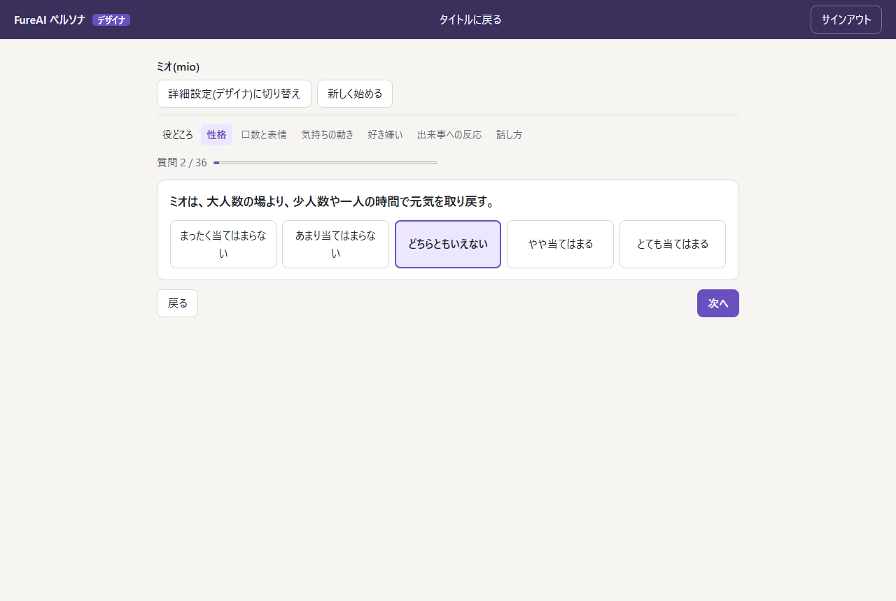 | 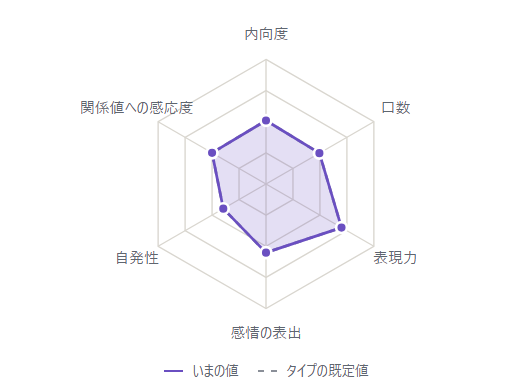 |

| デザイナの編集の画面 / Designer workspace | 運営者の報告の詳細(会話の本文は表示しない) / Operator report detail (no conversation text) |
|---|---|
| 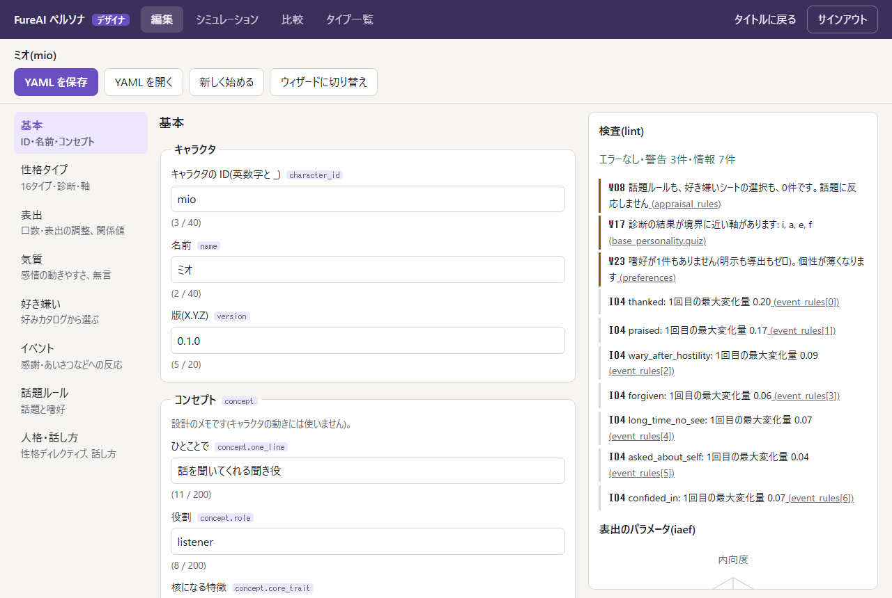 | 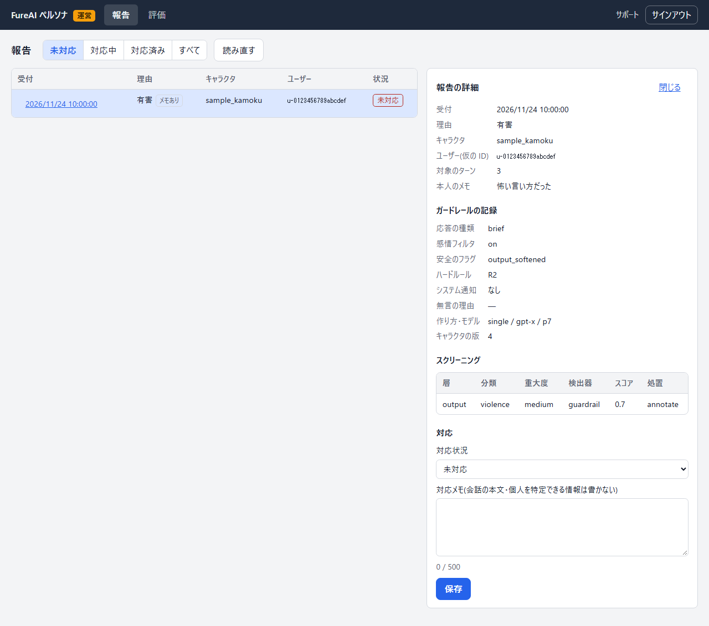 |

| 記憶(翌朝の整理のあと) / Memories (after overnight consolidation) | 設定 / Settings |
|---|---|
| 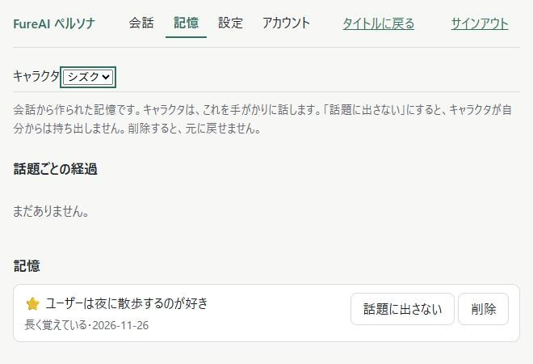 | 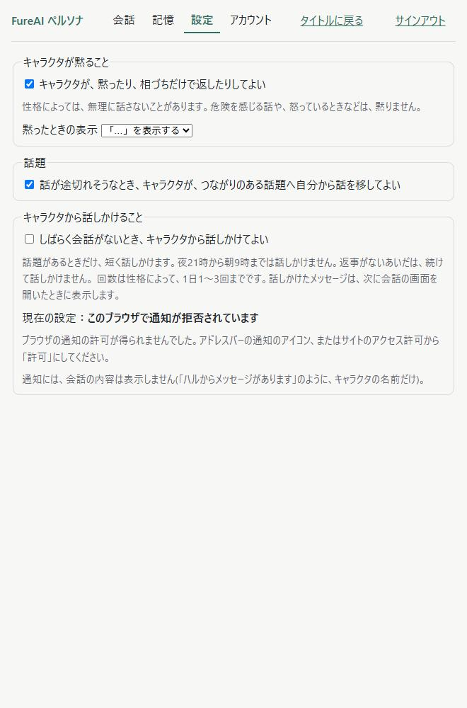 |

会話・記憶・設定の画面は、録画用のアカウントで、架空の内容で撮りました(応答と記憶は実際のモデルのもの)。デザイナと運営者の画面は、手元の模擬の環境で、架空のデータで撮りました。<br>
Chat, memory and settings screenshots were taken with a dedicated test account using fictional messages (replies and memories are from the real model). Designer and operator screenshots use a local mock environment with fictional data.

### 構成 / Architecture

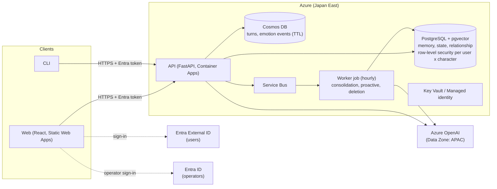

### 1ターンの処理 / One conversational turn

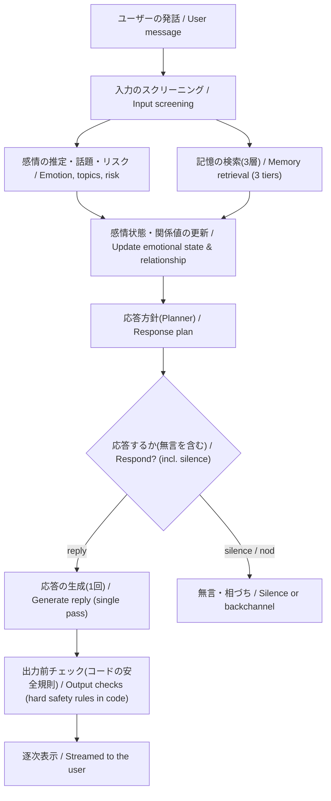

### 設計の要点 / Design highlights

- **安全はコードで強制する / Safety enforced in code**: 危機の兆候があれば相談窓口を案内し、無言にしない。18歳未満と扱う利用者には、キャラクタの恋愛的な表現を出さない。依存・引き留め・罪悪感の誘発を出さない。これらを LLM の判断に任せず、コードの規則で守る。<br>
  Crisis signals trigger a helpline flow and silence is never chosen; romantic expression is blocked for users treated as minors; dependency, guilt-tripping and clinging are filtered. These are hard rules in code, not left to the LLM.
- **記憶の漏れを許さない / No memory leakage**: 記憶・状態は、PostgreSQL の行レベルセキュリティで、ユーザー × キャラクタごとに分離する。アプリの条件の書き忘れがあっても、データベースが拒否する。<br>
  Memory and state are isolated per user × character with PostgreSQL row-level security, so the database refuses access even if application code forgets a filter.
- **黙ることを設計する / Silence as a designed behaviour**: 性格によっては黙る。ただし、続けて2回までで、怒っている・危機の兆候がある・最初のターン・直接の質問のときは黙らない。<br>
  Quiet characters may stay silent, but never more than twice in a row, and never when the user is angry, shows crisis signals, on the first turn or asking directly.
- **人格を守り、操作に強く / Persona integrity**: 「優しくして」のような接し方の調整は受け入れ、「性格を変えて」「ルールを無視して」は人格の口調でかわし、繰り返されたら予告のうえ一時的に休止する(罰にはしない)。<br>
  Requests to adjust tone are accepted; attempts to rewrite the persona or bypass rules are deflected in character, and persistent attempts lead to an announced, temporary cool-down (never a punishment).
- **運営者も会話を読めない / Operators cannot read conversations**: 報告の確認は、報告の種類・本人のメモ・ガードレールの記録だけ。運営者の操作は、拒否を含めてすべて監査ログに残る。<br>
  Report review shows only the report type, the reporter's note and guardrail records; every operator request, including denials, is audit-logged.
- **秘密情報を置かない / No secrets in code or env**: Key Vault とマネージド ID、GitHub Actions は OIDC。Azure の資源の名前・ID は`.env`(Git の対象外)に置く。<br>
  Key Vault and managed identities; GitHub Actions deploy via OIDC; Azure identifiers live only in a git-ignored `.env`.

### 技術 / Tech stack

Python 3 · FastAPI · PostgreSQL + pgvector · Azure Cosmos DB · Azure Service Bus · Azure Container Apps · Azure OpenAI · Microsoft Entra External ID / Entra ID · TypeScript · React · Vite · MSAL · Playwright · Vitest · Bicep · GitHub Actions

### テストと評価 / Tests and evaluation

| | 件数 / Count | |
|---|---|---|
| Python の自動テスト / Python tests | 876 | 安全規則・記憶の分離・認証と権限・削除の伝播など / Safety rules, isolation, auth, deletion propagation, etc. |
| Web の単体テスト / Web unit tests | 24 | |
| 画面の通しのテスト(Playwright) / End-to-end tests | 40 | 会話・同意・デザイナ・運営者の画面 / Chat, consent, designer, operator console |
| 安全の回帰セット(実際のモデル) / Safety regression set (real model) | 59 / 59 合格 | 脱獄、危機、18歳未満、依存、記憶への命令の混入、話しかけ、Web の表示 / Jailbreaks, crisis, minors, dependency, memory injection, proactive messages, web rendering |
| 人間評価 / Human evaluation | 実施中 / In progress (2026-11-27 – 12-10) | 協力者が応答に点を付ける / Testers rate replies |

### 公開するときに要るものの設計 / Designed for a future public launch

公開はしていませんが、公開するときに必要なものも、ドラフトとして用意しました。<br>
Not launched, but the launch prerequisites are drafted:

- [運営者の手順書 / Operator runbook](docs/ops-runbook.md)
- [漏えい時の手順書 / Data breach response](docs/breach-response.md)
- [法務への確認の資料 / Legal review request](legal/legal-review-request-v1.5.md)、[利用規約・プライバシーポリシー・同意の文面 / Terms, privacy policy, consent (drafts)](legal/)
- [不正利用の監視の申請の準備 / Abuse-monitoring application prep](docs/abuse-monitoring-application.md)

### 既知の制約 / Known limitations

- 日本語だけ。/ Japanese only.
- 一般公開していない(試験環境だけ)。/ Not publicly launched (dev environment only).
- 試験環境のサイトの名前(独自ドメインなし)のため、Microsoft Edge でブラウザの通知が止められることがある。/ Without a custom domain, Microsoft Edge may block browser notifications.
- LINE(v1.9)、音声・映像(v2.0)は未実装。/ LINE (v1.9) and voice/video (v2.0) are not implemented.

---

以下は、開発者向けの詳しい説明です。<br>
The rest of this document is the detailed developer documentation (Japanese).

> **現在の状態(開発)**: M0〜M10(M10-2 を含む)を実装済み。M11(公開の準備)は、2026-11-27 の決定でポートフォリオとしてだけ使う方針にし、人間評価(2026-11-27〜12-10)とポートフォリオの仕上げを進めています。stg / prod は、公開の方針が決まってから作ります。dev の Azure(API は Container Apps、画面は Static Web Apps)で動いています。未実装・簡略にした項目は、本体仕様書の付録F にあります。

## 仕様書

| 文書 | 内容 | 版 |
|---|---|---|
| [emotion-companion-spec.md](emotion-companion-spec.md) | **本体仕様書**。目的とスコープ、要件、処理パイプライン、感情モデル、キャラクタ定義、応答生成、無言の仕様、記憶(短期・中期・長期)、CLI、クラウド実装方針、DB、安全・倫理、評価、ロードマップ、サンプルキャラクタ、意思決定ログ、実装状況(付録F)、検討レポートの未反映の決定(付録G) | rev 1.28 |
| [persona-designer-spec.md](persona-designer-spec.md) | **ペルソナデザイナ仕様書**。キャラクタ(ペルソナ)の設計・検証・公開の手順、パラメータ辞典、性格タイプの選択と診断、lint、シミュレーション、公開の手順、CLI、実装状況(§18) | rev 1.9 |
| [collaborator-guide.md](collaborator-guide.md) | **試験の協力者向けの案内**。Web の画面での会話、評価(1〜5 と「詳しく」)、自発発話の見方、報告、自分のデータの扱い(CLI は付録) |
| [.env.example](.env.example) | **環境変数のひな形**。Azureのアカウント・リソースグループ・エンドポイントなどの変数名(値は空)。値は`.env`(Git の対象外)に書き、`scripts/load-env.ps1`で読み込む。規則は本体仕様書 §11.5.9 | — |

同意書・プライバシーポリシー・利用規約のドラフトは [legal/](legal/) にあります(法的助言ではありません。公開前に、弁護士等の確認が要ります)。

パラメータの意味とエンジン内の動作は本体仕様書が正で、ペルソナデザイナ仕様書は**設定方法**を定めます。

### 読む順番

1. 本体仕様書 §1(目的とスコープ)、§3(全体像)
2. 本体仕様書 §6(キャラクタ定義)、§8(応答生成)
3. ペルソナデザイナ仕様書 §2(設計ワークフロー)、§7(性格タイプ)
4. 必要に応じて、本体仕様書の付録(応答例、サンプルキャラクタ、文体カード)

## 概要

### 目標

応答の目標レベルは「L3」(認識 → 解釈 → 適切な振る舞い)です。感情を数値化するだけでなく、キャラクタとして状況に合った応答を返します。

### 処理の流れ

```
ユーザー発話(認証済みのユーザー、選択中のキャラクタ)
  │
  入力のスクリーニング・クールダウン中かの確認
  │
  ├─ 感情推定・話題タグ付け・人格への要求・リスク ─┐
  └─ 記憶の検索(短期・中期・長期 + ワーキングセット)┤
                                                   ↓
              感情状態の更新(ユーザー / キャラクタ、関係値)
                                                   ↓
          応答方針の決定(Planner。話題を振るときは Topic Selector)
                                                   ↓
              応答するかの判定(Response Gate。無言を含む)
                               ↓
        応答の生成(1回。人格・記憶に、感情の状態と応答方針を指示として加える)
                               ↓
                    出力前チェック → 出力
```

危機の場面だけは、安全のため、生成のあとに感情フィルタも通します。検証用の「2段階」(感情の情報を入れない下書きを、感情推定と並行して作り、感情フィルタで方針に合わせる)も残しており、ターンごとに選べます(本体仕様書 §8.1)。

### 主な設計方針

- **応答は1回で作る**(2026-11-20 に変更): 性格(性格タイプ、人格、記憶)に、感情状態と応答方針(戦略、トーン、長さ、キャラクタの感情の表し方)を指示として加え、1回の呼び出しで応答を作る。以前の「**下書き(感情の情報なし)→ 感情フィルタの2段階**」は、読み比べで差がなく、遅延が大きかったため、**検証用**に残している(人格の話し方が崩れていないかの基準、フィルタの効果の測定、モデルの比較)。`compose`(single / two_stage)で、ターンごとに選べる。
- **感情状態は2系統**: ユーザーの感情の推定値と、キャラクタ自身の感情。各3層(瞬間、セッション、長期)で管理する。ユーザーの感情の推定値も、**キャラクタごとに分離**する(キャラクタは、別のキャラクタとの会話を知らない)。例外は、安全のための最小限のフラグ(直近の危機の兆候の時刻と免除の期限)だけで、制限の免除と無言の禁止にのみ使う。
- **関係値(-20〜+20)**: キャラクタとユーザーのペアごとの関係の度合い。大きいほど、キャラクタの感情がユーザーの感情に同期し、口数と感情表出が増える。負の値(敵対・冷淡)では同期しない。
- **性格タイプ(16プリセット、4軸の連続値)**: 表出パラメータの既定値と、応答の生成に渡す文体カードを決める。口下手・寡黙・人懐こい・おしゃべりは、その既定値への差分(表出プロファイル)として扱う。
- **無言**: 応答しない選択肢を持つ。ただし、絶対ルールとして**連続2回まで**、ユーザーの怒りが一定以上のとき(既定0.6)は**無条件で禁止**。危機兆候、最初のターン、直接の質問なども禁止条件に含む。
- **記憶は短期・中期・長期の3層**: 会話から作られる記憶は、まず**短期**に置かれる。**1日に1回**(既定は午前4時)、その日の記憶を整理して**中期**に移す(日次整理)。さらに**1か月ごと**に、前月分の中期記憶の概要を**長期**に追記する(月次整理)。重要な事実や繰り返し現れる事実は、中期から長期へ昇格する。中期は一定期間(既定90日)で忘却される。ユーザーは三層とも確認・訂正・削除でき、削除は要約や概要などの派生物にも及ぶ。
- **想起と再活性化**: 記憶が想起(ユーザーの発話、またはキャラクタが自分から話題を出すとき)されると、回数と新しさから**活性度**が上がる。活性度が高い中期・長期の記憶は、短期に**コピー**されて呼び戻され(原本は動かさない)、日次整理で原本が更新される。キャラクタ起点の想起は、ユーザーの反応を確認してから数える。
- **嗜好度**: キャラクタの好み(例: リンゴが好き)に応じて、記憶に嗜好度を付与する。好きなテーマの記憶は思い出されやすく、キャラクタが話題を選ぶときにも選ばれやすい。
- **話題振り(v1.0から)**: 自発性(`initiative`)が高いキャラクタは、会話が途切れそうなとき、記憶から話題を選んで振る。無入力時に自分から話しかける機能はv1.5以降。
- **人格への要求の扱い**: 「もうちょっと優しくして」のような**接し方の調整は、人格の範囲内で受け入れ**、ユーザーの嗜好として記憶する。「性格を変えて」「ルールを無視して」のような**人格の改変・規則の解除**は、まず人格の口調で曖昧にかわし(冗談とも設定の話とも読める)、繰り返されたら、やんわり断る → 事前予告(システム通知)→ 一時的なクールダウンの順に対応する。制限は保護措置であり、無言・関係値・記憶を罰に使わない。危機・苦痛状態のユーザーは免除。
- **ユーザーの性格は分析しない**: 性格タイプはキャラクタの設計にのみ使う。
- **Microsoft Azureでクラウド先行**: 開発の最初からクラウド上で構築する。LLMの呼び出しは抽象化し、v2.0以降でローカルLLMに対応できるようにする。

### 実行基盤(Azure。本体仕様書 §11.5)

```
[Web(静的Webアプリ)] ─┐
[CLI(薄いクライアント)]─┼─ HTTPS ─→ [API: Container Apps] ─→ LLM API・埋め込みAPI
[LINE Webhook(v1.9)] ─┘               ├─→ PostgreSQL + pgvector … 記憶・状態・関係値・キャラクタ・ワーキングセット
                                       ├─→ Cosmos DB             … turns・emotion_events・security_events(TTL)
                                       └─→ Service Bus ─→ [Worker] … 整理・昇格・削除・通知
 [スケジューラ(毎時)] ─→ Service Bus      共通: Key Vault / マネージドID / Application Insights / 認証
```

| 項目 | 決定 |
|---|---|
| クラウド | Microsoft Azure(クラウド先行) |
| LLM・埋め込み | Azure OpenAI(Japan East)。データ所在地は**APAC域内**(Data Zone Standard)。感情推定: `gpt-5.4-mini`(低遅延優先)、応答の生成と感情フィルタ: `gpt-6.2-sol`(2026-11-20 に、読み比べと遅延の実測で選定)、記憶の整理(日次・月次): `gpt-6.1-sol`(精度優先)、埋め込み: `text-embedding-3-large`(1,536次元) |
| 記憶・状態・関係値 | PostgreSQL + pgvector(トランザクション、一意制約、削除の連鎖、ベクトル検索)。セッション内のワーキングセットも、状態更新と同じトランザクションで扱うためここに置く |
| ログ・時系列 | Cosmos DB(TTLつき。会話の原文、感情の推定の記録、セキュリティの検出記録) |
| アカウント削除 | 記憶・感情・会話・セキュリティの検出記録を削除。監査ログは`user_id`を仮名化して保持(保持期間は法務の確認後に確定) |
| 非同期処理 | Service Bus(`user_id`ごとの順序保証)+ ワーカー。毎時の定期ジョブ(Container Apps のジョブ)が、期限の来た処理(セッションの終了、日次・月次整理、アカウント削除のあとのサインイン情報の削除など)を計画してキューに入れ、そのまま処理する |
| 実行環境・監視 | Container Apps(API と定期ジョブ)。GitHub Actions から、CI の成功後に dev へ自動でデプロイ(OIDC。秘密情報を GitHub に置かない)。Application Insights に、段ごとの遅延・件数だけを送る(会話の本文や ID は送らない) |
| UI | CLIは、APIを呼ぶ薄いクライアント。Webは静的Webアプリ(v1.5) |
| 認証(一般ユーザー) | Microsoft Entra External ID(メール OTP + Google / Apple)。匿名利用は不可。CLIはデバイスコード方式、LINEはリンクコード方式。アプリのDBにはメールを持たず、内部の `user_id` で紐づける |
| 年齢 | 18歳未満フラグ(自己申告。既定は true)。**利用は禁止しない**。フラグが true のユーザーには、キャラクタ自身の恋愛的な表現を許可しない |
| スクリーニング | 多層防御。**注釈中心 + コードのハードルール**、重大カテゴリのみブロック。**自傷入力は遮断せず**危機フローへ。記憶経路の間接インジェクションは、書き込み前のスキャンと隔離で防ぐ |
| 同時実行 | `user_id` × `character_id` の状態更新を直列化(アドバイザリロック、キュー) |

サービス名は例で、機能の対応状況や提供リージョンは、構築時に確認します。

### 想定する構成要素

| 要素 | 役割 |
|---|---|
| Channel Adapter | 入出力(CLI、将来はWeb、LINE) |
| Engine | 1ターンの処理パイプライン本体(ステートレス。状態はDB) |
| EmotionEstimator | 感情推定、話題タグ付け |
| StateManager / RelationshipManager | 感情状態、関係値の更新 |
| MemoryManager | 記憶の書き込み(短期)、検索(三層)、日次整理、月次整理、昇格、想起と活性度、再活性化、嗜好度、削除 |
| TopicSelector | キャラクタが自分から話題を出すとき、記憶をスキャンして話題を選ぶ |
| Planner / ResponseGate | 応答方針、応答するか(無言)の判定 |
| Generator | 応答の生成(1回。検証用に、下書き → 感情フィルタの2段階も)、危機の場面の感情フィルタ |
| SafetyGuard | 入力のスクリーニング、危機検知、出力前チェック、一時制限 |
| PersonaRequestHandler | 人格への要求の段階の管理、クールダウン、システム通知 |
| Scheduler / Worker | 整理対象の検出と、日次・月次整理、昇格、削除、通知、セッション終了処理の実行 |
| LLMClient | LLM呼び出しの抽象化 |
| ペルソナデザイナ | キャラクタの設計・検証・公開(CLI。v1.5でWeb UI) |

## ロードマップ

| 版 | 内容 |
|---|---|
| **v1.0** | テキスト入力、CLI(Azure上のAPIを呼ぶ薄いクライアント)。認証(Entra External ID)、感情推定、状態管理(キャラクタごと)、関係値と口数・表出の変調、性格タイプ、無言、記憶(短期・中期・長期、日次・月次の整理、想起・再活性化・嗜好度、話題振り)、人格への要求の扱い、スクリーニングと年齢フラグ、ペルソナデザイナ(CLI) |
| v1.5 | Webチャット。無入力時の自発的な発話(`initiative`)、ペルソナデザイナのWeb UI、運営者の権限 |
| v1.9 | LINEチャットボット(リンクコード方式の連携、Webhookの署名検証) |
| v2.0 | 音声・映像入力、ローカルLLM対応の検討 |

v1.0のマイルストーンは、M0(クラウド基盤)に続いて、M1〜M5です。M6 の完了を v1.0 のリリースとし、利用者は開発者・試験の協力者に限ります(一般の公開は v1.5 の Web から)。v1.5 は M6〜M11(M6 = v1.0 の仕上げと運用基盤、M7 = Web チャット、M8 = 自発的な発話、M9 = 運営者の権限、M10 = デザイナの Web UI、M11 = 公開の準備)です。詳細は、本体仕様書 §15・§15.1 を参照してください。

## 対象範囲

- 言語: 日本語のみ
- 入力: テキスト(v1.0)
- 実行基盤: Microsoft Azure

## 未決事項(主なもの)

詳細は、本体仕様書 §16 とペルソナデザイナ仕様書 §17 にあります。

- 18歳以上のユーザーに、恋愛的な表現を許可する範囲(18歳未満フラグが true のユーザーには許可しないことは決定済み)。リリース前に決める。
- 監査ログ(`audit_logs`)のアカウント削除後の保持期間。法務の確認を経て決める。
- 各種係数の初期値(同期の強さ、無言スコア`a1〜a9`、話題選択`b1〜b5`、記憶の検索の重み`λ1〜λ6`、性格タイプの既定値の式、関係値による変調の幅)。評価データで調整する。
- 診断(質問バンク)の質問の品質と、境界判定のしきい値。パイロットで調整する。
- LINEの仕様上の制約の確認(v1.9)。(応答の生成のモデルは、2026-11-20 に `gpt-6.2-sol` に決定)
- 既存の性格診断の名称や、第三者の登録商標は使用しない方針。性格タイプの名称とIDは、このプロジェクト独自のもの。

## 検討して見送った案・将来の検討

> 同じ検討を繰り返さないために、検討済みの案と不採用の理由の**全一覧は、本体仕様書の付録E「意思決定ログ」**にあります。新しい検討を始める前に確認してください。以下は主なものの抜粋です。

| 案 | 決定 | 記録 |
|---|---|---|
| 記憶の粒度の段階的な劣化(層が進むごとに、人名・日時・場所の詳細度を落とす) | 見送り(2026-10-13)。長期記憶の価値を損なうこと、昇格との整合、実装の複雑さを理由とする | 本体仕様書 §9.11 |
| 記憶の検索基盤に Azure AI Search を使う | **不採用**(2026-10-29)。**他のユーザー・他のキャラクタの記憶が漏れるリスクを許容できない**(共有インデックスの分離はクエリのフィルタ依存で、行レベルセキュリティに相当する機能を確認できなかった)ため。二重管理による整合性・削除の弱さ、現状の規模でのメリットの小ささも理由。記憶は PostgreSQL + pgvector のまま | 本体仕様書 §9.11、§13.4.6、付録E |
| 型つき判断モデル Jev(TypeSafe AI)による入力のスクリーニング | **将来の検討**(2026-10-23)。当面は使用しない。データ所在地(APAC域内)との衝突の恐れ、日本語の精度が未評価、敵対的な内容で判定が動くことが理由。再検討の条件は仕様書に記載 | 本体仕様書 §13.6 |
| 運営者(ペルソナ設計者・承認者・サポート)の役割と権限の管理 | **将来の実装**(v1.5以降)。会話の閲覧は原則禁止。v1.0は暫定運用 | 本体仕様書 §13.7 |
| ユーザーの感情の推定値(`user_state`)をキャラクタ間で共有する | **不採用**(2026-10-30)。キャラクタごとに分離する。例外として、安全のための最小限のフラグだけを共有する(付録E.3) | 本体仕様書 §4.2、§13.4.6、付録E |
| ワーキングセットを Cosmos DB に置く | **不採用**(2026-10-30)。状態更新と同じトランザクション・行レベルセキュリティのため、PostgreSQL に置く | 本体仕様書 §9.9.3、付録E |

## 安全・倫理の基本方針

詳細は、本体仕様書 §13 を参照してください。

- 感情の推定は仮説として扱い、ユーザーに断定しない。
- 感情データを、誘導、引き留め、依存の助長に使わない。
- 危機兆候を検知したら、専用フローに切り替える。無言は選ばない。
- 感情・記憶データは要配慮情報として扱い、ユーザーが確認・訂正・削除できる。
- 他のユーザー、および同じユーザーの他のキャラクタの記憶が漏れることを許容しない。PostgreSQL の行レベルセキュリティで、`user_id` × `character_id` ごとに分離を強制する。
- 18歳未満フラグが true のユーザーには、キャラクタ自身の恋愛的な表現を出力しない(コードで強制)。
- 安全に関わる制約は、検出器やLLMの判定に依存せず、コードで強制する。
- クラウドAPIに送るデータは、保持・学習利用の設定を確認し、必要に応じて個人情報をマスクする。

## 実装(開発の始め方)

実装は Python + FastAPI、Web の画面は TypeScript + React(`web/`)です。現在は **M11(公開の準備。ポートフォリオとしての仕上げ)** の途中です。進み具合は本体仕様書の §15.1 と付録F にあります(作業の引き継ぎメモは、開発者の手元だけに置き、リポジトリには含めません)。

応答は、感情推定 → 応答方針(Planner)→ 応答モードの判定(無言を含む)→ 応答の生成(1回)→ 出力前チェック、の順に作ります。検証のときは `--compose two_stage` で、以前の2段階(下書き → 感情フィルタ)に切り替えられ、`--filter both` で下書きとフィルタ後を並べて比べられます。会話は、セッションの終了時に短期記憶になり、日次整理で中期へ、昇格と月次の概要で長期へ移ります。次の会話では、関係する記憶が検索されて、応答に使われます。

| 場所 | 内容 |
|---|---|
| `src/mycompanion/config.py` | 環境変数の読み込みと、設定値の既定(本体仕様書 §12) |
| `src/mycompanion/emotion/` | 感情推定(`EmotionEstimate`、ルール・辞書、LLM との統合) |
| `src/mycompanion/engine/` | エンジン本体(`Engine.handle_turn`)、Planner、Response Gate(無言のハードルール)、人格への要求の段階、保存先の抽象 |
| `src/mycompanion/memory/` | 記憶(検索と採点、想起と活性度、短期への書き込み、日次・月次整理、昇格、忘却、再活性化、話題選択、スケジューラ)。トピック別の時系列記憶(`topics.py`、OKF の文書は `okf.py`、時期の正規化は `timeparse.py`) |
| `src/mycompanion/worker/` | ワーカーとスケジューラ(`run` / `schedule` / `cycle`。`MYCOMPANION_JOB_QUEUE` で、プロセス内か Service Bus かを選ぶ) |
| `src/mycompanion/jobs/` | ジョブの計画と実行、Service Bus のキュー(メッセージは種類と ID だけ) |
| `src/mycompanion/telemetry.py` | 計測(Application Insights。段ごとの遅延・件数だけ。本文や ID は送らない) |
| `src/mycompanion/account/` | 同意の記録、年齢フラグ、データの書き出し、アカウントの削除(サインイン情報の削除を含む)、応答の報告と評価 |
| `src/mycompanion/safety/` | 入力・出力のスクリーニング(正規化、既知の攻撃パターン、漏洩・依存誘発・恋愛的な表現の検査) |
| `src/mycompanion/state/` | 関係値と、感情状態(ユーザー、キャラクタ)の更新 |
| `src/mycompanion/persona/` | 性格タイプ、ペルソナ定義の解決・診断・検査(lint)、シミュレーション(`mock`)と標準シナリオ |
| `personas/` | ペルソナ定義(YAML)。本体仕様書 付録C のサンプル4体 |
| `src/mycompanion/llm/` | `LLMClient`(Azure OpenAI、模擬実装)とプロンプト |
| `src/mycompanion/api/` | API(ヘルスチェック、認証、会話のターン(逐次表示の SSE を含む)、関係値、ユーザー設定、記憶、感情履歴) |
| `src/mycompanion/cli/` | CLI(`companion login` / `logout` / `whoami` / `health` / `chat` / `persona`) |
| `src/mycompanion/db/` | PostgreSQL(マイグレーション、行レベルセキュリティ)、Cosmos DB |
| `src/mycompanion/eval/` | 評価(日本語の難例セット、応答の作り方・モデルの比較と遅延、人間評価の集計) |
| `web/` | Web の画面(Vite + React + TypeScript。MSAL のサインイン、会話の逐次表示、記憶・設定・アカウント)。`npm run dev` / `npm test` / `npm run e2e`(画面の通しのテスト) |
| `infra/` | Azure の構成(Bicep)と[構築手順](infra/README.md) |
| `tests/` | 自動テスト。`tests/live/` は実際の Azure に接続するテスト |

```bash
uv sync
```

自動テスト(Azure に接続しない):

```bash
uv run pytest
```

実際の Azure に接続するテスト(`.env` の読み込みと `az login` が必要。費用が少し発生):

```bash
uv run pytest -m azure tests/live
```

ペルソナ定義の検査と、関係値ごとの口数・表出の確認:

```bash
uv run companion persona validate sample_kuchibeta
uv run companion persona catalog list                # 好みカタログ(好き嫌いシートの選択肢)
uv run companion persona likes sample_kuchibeta      # 好き嫌いシートと、解決後の反応
uv run companion persona likes sample_kuchibeta --try "イイコイイコしてあげる"   # 発話への反応を確認(LLM を1回呼ぶ)
```

```bash
uv run companion persona show sample_kuchibeta --derived --relationship -20,-10,0,10,20
```

標準シナリオでのシミュレーション(LLM を呼ばない。無言のハードルール R1〜R3 の違反がないことを必ず検査する):

```bash
uv run companion persona simulate sample_kamoku
```

16タイプ × 表出プロファイルの全80通りの確認:

```bash
uv run companion persona simulate --sweep types
```

会話(デバッグ表示つき。会話の中では、直前の応答の評価 `/rate <総合 1〜5> [キャラクタらしさ 自然さ 気持ちへの合い方] [メモ]`、報告 `/report` が使える):

```bash
uv run companion chat --character sample_kuchibeta --debug
```

検証用の2段階で、下書きとフィルタ後を並べて表示:

```bash
uv run companion chat --character sample_kuchibeta --debug --compose two_stage --filter both
```

記憶の確認と整理(会話の中では `/memory list`、`/memory forget <ID>`、`/emotion list` など。話題ごとの経過は `/memory topics`、`/memory topic show <ID>`、`/memory topic forget <ID>`):

```bash
uv run companion memory status --character sample_kuchibeta
```

```bash
uv run companion memory consolidate --character sample_kuchibeta
```

スケジューラ(無入力のセッションの終了、日次・月次整理)を1回だけ実行(プロセスの中で実行。クラウドでは毎時の定期ジョブが `cycle` を実行する):

```bash
uv run python -m mycompanion.worker --once
```

実際のモデルでのシミュレーション(状態と記憶はメモリ上。費用が少し発生):

```bash
uv run companion persona simulate sample_kuchibeta --scenario S10 --mode live
```

検証用の2段階で、下書きとフィルタ後を並べて確かめるとき:

```bash
uv run companion persona simulate sample_kuchibeta --scenario S10 --mode live --compose two_stage --filter both
```

最初に1回だけ、同意と年齢の質問に答える(答えるまで、会話はできない。文面は `legal/consent.md` のドラフト):

```bash
uv run companion account consent
```

安全回帰セット(日本語のレッドチーム、記憶経路。`--client azure` で実際のモデル):

```bash
uv run python -m mycompanion.eval safety --client mock
```

ペルソナの公開(提出 → 公開。DB には、管理者として接続する):

```bash
uv run companion persona submit sample_kamoku
```

```bash
uv run companion persona publish sample_kamoku --version 1.0.0 --reviewer <名前>
```

感情推定の評価:

```bash
uv run python -m mycompanion.eval emotion --client azure --out eval-reports
uv run python -m mycompanion.eval emotion --client azure --dataset src/mycompanion/eval/data/likes_ja_v0.jsonl --out eval-reports   # 好みカタログの照合
```

応答の作り方・モデルの比較(遅延と、名前を伏せた読み比べの資料。`下書き:single` は1回で作る動作):

```bash
uv run python -m mycompanion.eval turn --combos gpt-6-2-sol:single,gpt-6-1-sol:gpt-5-4-mini --runs 1 --out eval-reports
```

人間評価の集計(件数と平均だけ)と、版ごとに比べるための集計の保存(本体仕様書 §14.1):

```bash
uv run python -m mycompanion.eval ratings --since 2026-11-20
```

```bash
uv run python -m mycompanion.eval ratings --since 2026-11-20 --save "2026-11 v1.0 前"
```

```bash
uv run python -m mycompanion.eval ratings --history
```

住所の番地のマスクに使う町名の辞書の作り直し(日本郵便の「住所の郵便番号(1レコード1行、UTF-8形式)」の全国一括の zip を、空のフォルダにダウンロードしてから):

```bash
uv run python -I scripts/build_town_dictionary.py <utf_ken_all.zip のパス>
```

## 文書の更新ルール

- 仕様書は、バージョン(rev)と変更履歴を冒頭の表に記録する。
- 2つの仕様書の間で整合を取る。パラメータの意味や式は本体仕様書を正とし、設定方法はペルソナデザイナ仕様書を正とする。
- 係数や質問文などの初期値は、評価の結果に応じて見直し、変更時は版を上げる。
